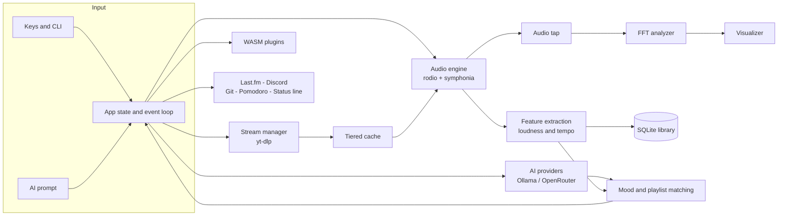

<h1 align="center">🎵 Symphony</h1>

<p align="center">
  <strong>A terminal music player that understands what you want to hear.</strong><br>
  Local files and YouTube, an AI that picks music by how it actually sounds, synced lyrics,<br>
  a live spectrum, and a status line for your shell. One Rust binary, no Electron.
</p>

<p align="center">
  <a href="https://github.com/Rcidshacker/Symphony/actions/workflows/ci.yml"></a>
  
  
  <a href="LICENSE"></a>
</p>

<p align="center">
  <a href="#install-and-run">Install</a> ·
  <a href="#what-you-can-do">Features</a> ·
  <a href="#keys">Keys</a> ·
  <a href="#how-it-works">How it works</a> ·
  <a href="#honest-status">Honest status</a> ·
  <a href="docs/USER_GUIDE.md">User guide</a> ·
  <a href="#contributing">Contributing</a>
</p>

```text
┌──────────────────────────────────────────────────────────────────────────────────────────────────────┐
│🎵  SYMPHONY v2.0 | Theme: monokai | AI-Powered Terminal Music Player                                  │
└──────────────────────────────────────────────────────────────────────────────────────────────────────┘
┌ 🖼️  Night Drive ──┐┌ 🎵  NOW PLAYING ─────────────────────────────────────────┐┌ 📊  SPECTRUM  ─────────┐
│                  ││▶ Playing  [LOCAL]                                       ││                       │
│                  ││Night Drive                                              ││                       │
│                  ││Neon Harbor · 0:02 / 3:34                                ││                       │
│                  ││                                                         ││     ▀▀    ▀           │
│                  │└─────────────────────────────────────────────────────────┘│    ▀██    █    ▀    ▀ │
│        ♪         │┌ Progress ───────────────────────────────────────────────┐│    ███    █    █    █ │
│       ♫♪♪        ││█                      0:02 / 3:34                       ││    ███   ▀█    █    █ │
│      ♪♪♪♪♪       │└─────────────────────────────────────────────────────────┘│    ███   ██    █    █ │
│       ♪♪♪        │┌ 🔊  ─────────────────────────────────────────────────────┐│   ▀███▀  ██    █    █ │
│        ♪         ││████████████████████████VOL: 60% █                       ││  ▀█████  ██    █    █ │
└──────────────────┘└─────────────────────────────────────────────────────────┘└───────────────────────┘
┌ 📚  LIBRARY ──────────────────────────────────────────────────────────────────────────────────────────┐
│› ▶ Neon Harbor - Night Drive (3:34)                                                                  │
│    Mika Sato - Paper Lanterns (3:07)                                                                 │
│    The Low Tide - Static Bloom (4:01)                                                                │
│    Voltage - Gym Anthem (2:56)                                                                       │
│    Oak & Ember - Sunday Stroll (3:23)                                                                │
│    Ida Wren - Melancholy Rain (4:28)                                                                 │
│                                                                                                      │
│                                                                                                      │
│                                                                                                      │
│                                                                                                      │
└──────────────────────────────────────────────────────────────────────────────────────────────────────┘
┌──────────────────────────────────────────────────────────────────────────────────────────────────────┐
│📊  Bars │ 📁  6 tracks │ Playing: Neon Harbor - Night Drive                                            │
│space play/pause · n/p next/prev · +/- volume · m mute · s shuffle · r repeat · q quit                │
│/ search · a ask AI · l lyrics · x translate · w pomodoro · v visualizer · t theme · ? help           │
└──────────────────────────────────────────────────────────────────────────────────────────────────────┘
```

<p align="center"><sub>This is the player's real output (ratatui's test backend rendering a six-track library while a chord plays), not a mock-up.</sub></p>

---

## Why Symphony

Most terminal players play files. Symphony also listens to them.

* **Ask in plain words.** `symphony "play something energetic"` queues the tracks whose measured loudness and tempo fit, not the ones whose file names happen to contain the word.
* **Your shell knows what is playing.** `symphony status` feeds tmux, zsh, waybar, polybar and i3blocks.
* **Your commits set the mood.** Optionally, the queue moves from calm to energetic as your commits per hour climb.
* **Honest about itself.** Every feature below is wired in and covered by tests, and the [status table](#honest-status) says exactly how each one was verified and what is missing.

## Install and run

You need Rust 1.88 or newer. On Linux also install the ALSA headers: `sudo apt install libasound2-dev pkg-config build-essential`.

```bash
git clone https://github.com/Rcidshacker/Symphony.git
cd Symphony
cargo build --release          # binary: target/release/symphony

symphony init                  # create the config and database
symphony scan ~/Music          # add your music
symphony                       # open the player
```

Optional: [`yt-dlp`](https://github.com/yt-dlp/yt-dlp) for YouTube, and either [Ollama](https://ollama.com) or an [OpenRouter](https://openrouter.ai) key for the AI assistant (OpenRouter has free models).

## What you can do

### 🤖 Talk to your library

Press `a` in the player, or pass a prompt on the command line.

```bash
symphony "play something calm"
symphony "create a 2-hour focus session"
symphony "more like Gym Anthem"
symphony "what should I listen to while debugging?"
```

| Say | You get |
|-----|---------|
| "play something energetic", "calm music" | Tracks ranked by measured loudness and tempo, analysed in the background and remembered |
| "play Radiohead", "some jazz" | Artist and genre matches from your tags |
| "a 2-hour focus session" | A playlist of about that length, calm tracks first, saved to your library |
| "more like Gym Anthem" | The tracks that sound most alike |
| "something sad" | Search by meaning (embeddings, with a plain-text fallback) |
| "what should I listen to while debugging?" | A short answer in a popup |
| "volume 30", "shuffle on", "skip" | The player obeys |

Works with Ollama or OpenRouter. Switch with `provider` under `[ai]`; details in [Configuration](docs/CONFIGURATION.md).

### 🌐 Play YouTube like local files

```bash
symphony stream "lofi hip hop"                          # search and play the best match
symphony add youtube:https://youtube.com/watch?v=...    # save a track to the library
```

Tracks are downloaded once into a tiered cache (hot, warm, cold) and played from there, so replays and the prefetched next track start instantly and work offline. The default pick skips livestreams and anything over 20 minutes, so a 12-hour loop is never "the song".

### 📊 See and read the music

* **Spectrum** computed from the audio that is actually playing: bars, waveform, circular, minimal (`v`, `1`-`5`). Five themes (`t`): monokai, gruvbox, nord, dracula, solarized-dark.
* **Lyrics**: a `.lrc` next to the song, or an automatic [LRCLIB](https://lrclib.net) lookup, with word-by-word highlighting. `x` translates them with your AI model.
* **Album art** from embedded covers or a `cover.jpg` beside the file, drawn with block characters.

### 💻 Built for developers

```bash
# tmux.conf
set -g status-right '#(symphony status tmux)'
# .zshrc
RPROMPT='$(symphony status zsh)'
```

* **Status line**: `symphony status [tmux|zsh|minimal|json|waybar|i3blocks|polybar]`.
* **Git-adaptive music**: with `adapt_music = true`, 0 commits in the last hour means calm, 1-2 steady, 3-5 driven, 6 or more energetic, applied at the next track change.
* **Pomodoro timer** (`w`), with calm focus music during work sessions.

### 🔌 Extend it

* **Last.fm**: now playing and scrobbling (`symphony lastfm-login`).
* **Discord Rich Presence**: show what you are playing.
* **WASM plugins**: sandboxed (the wasmi interpreter), permissioned, CPU-metered and memory-capped. The [plugin guide](docs/PLUGIN_DEVELOPMENT.md) walks through a working example, and the [API reference](docs/API.md) lists every host function and event.

## Keys

| Key | Action | Key | Action |
|-----|--------|-----|--------|
| `Space` | Play / pause | `a` | Ask the AI |
| `n` `]` / `p` `[` | Next / previous | `l` / `x` | Lyrics / translate |
| `+` `-` / `m` | Volume / mute | `v` `1`-`5` | Visualizer mode (`5` = off) |
| `s` / `r` | Shuffle / repeat | `t` | Theme |
| `j` `k` `Enter` | Move / play | `w` | Pomodoro |
| `/` | Search | `h` `?` | Help |
| `q` `Ctrl+C` | Quit | | |

## How it works



The idea that makes "play something calm" work: while you play music, Symphony measures each track's loudness and tempo in the background and remembers them in the library database. A mood is a target on those two axes, so the AI only has to understand your sentence; the ranking uses what the audio really sounds like.

## Measured performance

One run on the author's Windows 11 laptop with a release build, playing an MP3 and drawing the whole UI at 60 fps into an in-memory terminal (`cargo run --release --example perf_probe`). A single run, not a benchmark suite.

| | |
|--|--|
| Binary size | 11.6 MB |
| Start to first rendered frame | 77-93 ms |
| Memory while playing | 16-24 MB |
| CPU while playing | about 3.6% of one core |
| Frame time (update + draw) | 0.5 ms average |

## Honest status

**313 automated tests** (about 22k lines of Rust) run on Linux, macOS and Windows in CI, plus a clippy `-D warnings` gate, a formatting check, a security audit, and a build on the declared minimum Rust version. Playback tests need a sound device and skip themselves on machines without one, such as CI runners.

| Feature | Verified |
|---------|----------|
| Local playback, library, search, themes, visualizer, album art, lyrics files | Automated tests with real audio files |
| AI assistant | Automated tests against a mock Ollama; run live through OpenRouter with a free model |
| YouTube search, download, cache, playback | Automated tests with a fake `yt-dlp`; run live with the real one |
| Last.fm now-playing and scrobbling | Run live against a real account |
| LRCLIB lyrics lookup | Run live once |
| Status line, git-adaptive music, Pomodoro | Automated tests (real git repositories) |
| WASM plugins | Automated tests with hand-written WebAssembly; the example in the docs is run by a test |
| Discord Rich Presence, Ollama | Tested against fakes only: not run live |

**Not built:** seeking inside a track, crossfade, gapless playback, loudness normalization, a plugin SDK or marketplace. Spotify was dropped on purpose: its developer API requires the app owner to have Premium. **Platforms:** developed on Windows; Linux and macOS are built and tested by CI but not used by hand.

## Documentation

| | |
|--|--|
| [User guide](docs/USER_GUIDE.md) | Everything the player does |
| [Configuration](docs/CONFIGURATION.md) | Every setting, with which ones are actually read |
| [Plugin development](docs/PLUGIN_DEVELOPMENT.md) · [API](docs/API.md) | Write a WASM plugin |
| [Troubleshooting](docs/TROUBLESHOOTING.md) | Real error messages and what fixes them |
| [Changelog](CHANGELOG.md) | What changed |

## Contributing

Bug reports with a reproduction and small focused pull requests are welcome; start with [CONTRIBUTING.md](CONTRIBUTING.md). Before you push:

```bash
cargo fmt --all -- --check
cargo clippy --all-targets --all-features -- -D warnings
cargo test
```

## License

[MIT](LICENSE).

## Built with

[Ratatui](https://github.com/ratatui-org/ratatui) · [Rodio](https://github.com/RustAudio/rodio) · [Symphonia](https://github.com/pdeljanov/Symphonia) · [RustFFT](https://github.com/ejmahler/RustFFT) · [wasmi](https://github.com/wasmi-labs/wasmi) · [rusqlite](https://github.com/rusqlite/rusqlite) · [Tokio](https://tokio.rs) · [yt-dlp](https://github.com/yt-dlp/yt-dlp) · [LRCLIB](https://lrclib.net) · [Ollama](https://ollama.com)
